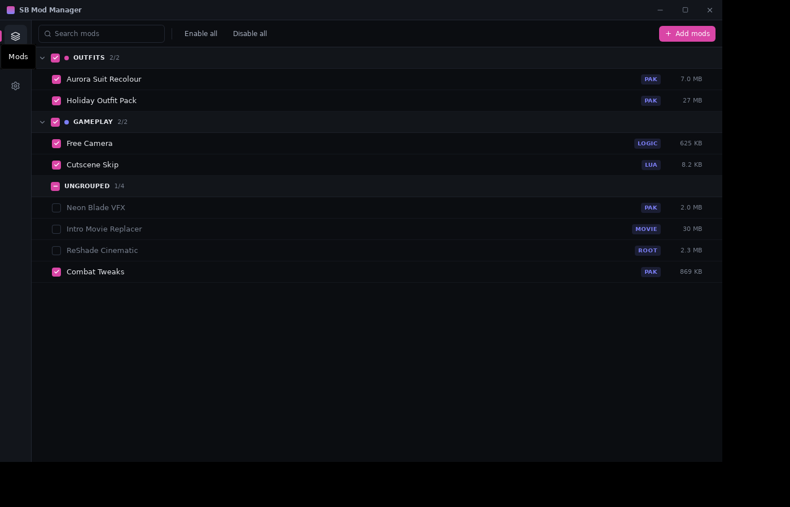

# SB Mod Manager

A mod manager for **Stellar Blade** (PC). It works out what a downloaded
archive is, puts each piece where the game expects it, and can put the game
folder back exactly as it found it.



## Why this exists

Stellar Blade mods do not all go in one place. A pak goes in `~mods`, a
Blueprint mod goes in `LogicMods` and will not work in `~mods`, a Lua mod needs
its own folder *and* a line in UE4SS's `mods.txt`, ReShade goes next to the
executable, and CNS packages ship a whole `SB/` tree to overlay. Getting this
wrong is the usual reason a mod "doesn't work".

## What it does

- **Detects the mod type and destination.** Nine layouts are recognised from
  structural markers rather than guesswork, and a single archive can contain
  several — a logic mod bundled with a cosmetic pak is routed as two
  independent components. When nothing is conclusive it asks once and
  remembers the answer.
- **Handles IoStore properly.** Stellar Blade is UE 4.26 with IoStore, so pak
  mods are `.pak`/`.utoc`/`.ucas` triplets that must share a base name and end
  in `_P`. Missing suffixes are fixed, incomplete sets are flagged.
- **Load order that actually applies.** `~mods` is mounted alphanumerically, so
  priority is written into the deployed file names (`0010_Outfit_P.pak`) with
  every file of a set renamed together. Logic mods are left alone, because
  UE4SS resolves those itself.
- **Enable and disable one mod, a group, or everything**, with the game folder
  reconciled in a single pass.
- **A virtual file system, like Mod Organizer 2's** *(experimental)*. Instead
  of linking mods into the game folder, the manager can leave the folder
  untouched and start the game under a hook that shows it the mods: every
  enabled mod is a layer over the real folder in load order, the one furthest
  down winning each file, and anything the game creates goes to an
  *overwrite* folder rather than the game. Proxy DLLs, UE4SS itself and the
  DLSS/frame generation swaps are still linked in, because Windows loads them
  before any hook exists — the job Root Builder does for Mod Organizer.
  Switching between the two modes carries every enabled mod across, and the
  game sees byte-for-byte the same folder either way.
- **Installs a batch in one go.** Drop or pick any number of archives; the ones
  it recognises install themselves and the rest queue up to be asked about, so
  nothing in the batch is lost.
- **Downloads from Nexus Mods.** Pressing *Mod Manager Download* on a mod page
  hands the file to the manager, which fetches it, works out what it is and
  installs it without another click. Nexus only gives direct links to Premium
  accounts, and that gate is respected rather than worked around: on a free
  account the manager opens each mod page for you and picks the link up from
  the button, which is one click per mod and nothing else. The queue survives
  a restart, and a part-downloaded file resumes rather than starting over.
- **Installs collections.** Paste a collection link and it lists what is in
  there, marks what you already have, and lets you pick the optional entries.
  Everything selected goes into the same queue, so Premium installs the lot
  unattended and a free account is one click per mod. Entries hosted off Nexus
  cannot be fetched for you and are listed separately rather than silently
  skipped — a collection that quietly drops them looks installed while the
  game is still missing mods.
- **Says which mod is actually winning.** Two mods can both be installed, both
  be enabled, and only one of them be doing anything, because they replace the
  same asset and the game loads whichever mounts last. The manager reads the
  `.pak` and `.utoc` indexes — only the indexes, so a scan costs kilobytes
  however large the mod is — and names the asset, the mods claiming it, and the
  one that reaches the game. Moving a mod down the load order changes the
  answer, so the list is something to act on rather than read.
- **Keeps the library where you want it.** Mods and backups can live on another
  drive; only the small database stays in the app data folder. If the library
  ends up on a different drive from the game, the app says so, because hard
  links stop working there and every enabled mod is then stored twice.
- **Updates DLSS and FSR.** Both ship as plain DLLs with a stable ABI within a
  release line, so a newer one can be dropped in without waiting for a game
  patch. Files come from the vendors' own repositories — `NVIDIA/DLSS` and the
  FidelityFX SDK — and the offer is narrowed by what the card can actually run
  and by which line the game is built against, so nothing is installed that the
  game would ignore or the hardware could never load. The swap goes through the
  same deployment record as a mod, so it undoes exactly.
- **Frame Generation on RTX 20 and 30 cards** *(experimental)*. NVIDIA only
  runs DLSS Frame Generation on RTX 40 and newer; the community project
  [dlssg_for_sm86](https://github.com/sdli1995/dlssg_for_sm86) gets it running
  on Turing and Ampere through a proxy DLL beside the game. The manager checks
  first whether it can work at all — the card has to be an RTX 20 or 30, the
  game has to ship DLSS Frame Generation for the proxy to take over, and the
  proxy's file name must not already belong to another mod — and only then
  offers to install. The release is fetched from the project's own GitHub
  releases, every file that goes into the game is checked against the
  archive's SHA-256 manifest, and only one proxy is ever put in place. It is
  deployed like any mod, so removing it puts the folder back exactly. If the
  game does not load `version.dll`, the other proxy names upstream ships can
  be chosen instead.
- **Says so on Discord**, if you want it to. Counts only — never the name of a
  mod, a collection or a folder — and one switch in Settings turns it off.
- **Updates itself** from GitHub releases, on either the stable or the nightly
  channel, with the download checked against a signature before anything is
  replaced.
- **Knows when a mod needs UE4SS.** Lua, C++ and Blueprint logic mods do
  nothing without UE4SS, and nothing on the outside says so. Every enabled
  mod that needs it is flagged while the game will not load UE4SS, with one
  button to install the build Stellar Blade needs — Chrisr0's fork of
  RE-UE4SS, from its GitHub releases — and an update check after that.
  Updating keeps your `UE4SS-settings.ini`, and UE4SS's own bundled mods
  (BPModLoaderMod among them, which every logic mod relies on) stay switched
  on under both deployment modes.
- **Profiles.** Keep several setups — say, vanilla, cosmetics only and
  everything — each with its own enabled mods and load order, and switch
  between them from the mod list; the game folder is brought in line on the
  spot. A new profile keeps the current order with nothing enabled; a
  duplicate keeps the enabled set too.
- **A Files view, like Mod Organizer 2's Data tab.** Browse the game folder as
  the enabled mods make it: every file is labelled with the mod, the game or
  the overwrite folder that provides it, and with the mods it hides. A
  Conflicts mode lists every clashing path at once.
- **Conflict flags in the mod list.** Beside each mod, as in Mod Organizer 2:
  `+N` when it replaces files of earlier mods, `−N` when later mods replace
  its own, both together, and *Redundant* when every file it has is replaced
  so it does nothing. Clicking a flag shows exactly which files.
- **Overwrite as a mod.** What the game creates under the virtual file system
  is listed under the mod list; one click turns it into a mod of its own,
  enabled where overwrite sat, so nothing the game sees changes.
- **One-click diagnostics.** Settings → Diagnostics writes a zip with a
  summary of the setup and every relevant log, for attaching to a report.
- **Leaves nothing behind.** Every file written and every original displaced is
  recorded, so disabling everything restores the folder byte for byte —
  including removing directories and the `mods.txt` it created, while never
  touching a file it did not put there.

## Status

Everything the plan set out is built and covered by tests. Two things are
worth knowing before the first real run:

- **The collection lookup has not met the live API.** Nexus does not publish
  its v2 GraphQL schema and the domain is unreachable from CI, so the query
  was written from the documented shape and the response is read by walking
  it for anything carrying a mod and file id rather than by a fixed path.
  That survives a renamed wrapper, but not a renamed `collectionRevision`
  itself. The `collection.json` inside the revision archive is the tested
  path and is preferred whenever the response offers a link to it.
- **The upscaler and frame generation checks need GitHub.** Listing releases
  uses the public GitHub API, which is rate limited for anonymous callers;
  when it refuses, the screen says it could not check rather than claiming you
  are up to date.
- **Frame generation on RTX 20/30 is third-party and experimental.** The
  compatibility check reads the card and the game folder; it cannot tell
  whether the game will actually load the proxy, which is why the other proxy
  names are offered. Edits to `dlssg_sm86.ini` are replaced when the package
  is reinstalled or updated.
- **The virtual file system is new.** Its rules are tested against real
  deployments, and the hook and launcher run end to end on every push —
  natively on Windows in CI, and under Wine with `scripts/test-vfs-wine.sh` —
  with a stand-in for the game, but not yet against the game itself. The
  hook redirects the Win32 file functions through import tables; code that
  reaches the file system some other way — directly through `ntdll`, say —
  sees the real folder. A Steam install started this way is told its app id
  so it does not relaunch itself through Steam; an Epic install may need the
  Epic launcher running.

## Building

Requires Rust 1.82+, Node 22+ and pnpm. On Windows you also need the WebView2
runtime, which ships with Windows 11 and recent Windows 10.

```sh
pnpm install
pnpm tauri dev      # run it
pnpm tauri build    # produce an installer
```

### Publishing a release

The version lives in `package.json` and nowhere else — `tauri.conf.json` points
at it, and the installer, the updater manifest and the in-app version all come
from there. So a stable release is two steps, in this order:

```sh
# 1. Bump the version and land it on master.
npm version 0.3.0 --no-git-tag-version   # edits package.json
git commit -am "Release 0.3.0" && git push origin master

# 2. Tag that commit and push the tag.
git tag v0.3.0 && git push origin v0.3.0
```

Pushing the tag builds the Windows installer and publishes a GitHub Release
with notes generated from the commits since the last tag. The tag must match
`package.json` exactly (`v0.3.0` ↔ `0.3.0`); the workflow refuses otherwise,
because a mismatched release publishes fine and is then never offered as an
update, which is a failure that looks like a success.

**Nightlies** need no action. At 03:00 UTC the workflow looks at `master`, and
builds a rolling `nightly` prerelease if anything landed in the last 24 hours —
so a quiet day publishes nothing, by design. To force one, run the *Release*
workflow from the Actions tab with `nightly` ticked.

The stable channel follows the newest `v*` release (the first was `v0.2.0`);
nightly follows the rolling `nightly` prerelease.

### Discord presence (optional)

Presence uses the project's own Discord application, whose id is `APP_ID` in
`src-tauri/src/discord.rs`. A fork that wants its own name on the presence
registers an application at <https://discord.com/developers/applications>,
puts its id in `APP_ID`, and uploads an image named `icon` under its Rich
Presence art assets so the large icon resolves.

### Update signing

The app updates itself from these releases and refuses anything without a
valid signature. The project's public key is committed in
`src-tauri/tauri.conf.json` (and as `.tauri/updater.key.pub`); its private half
is the repository secret `TAURI_SIGNING_PRIVATE_KEY`. A fork that publishes its
own releases needs its own keypair:

```sh
pnpm tauri signer generate -w .tauri/updater.key
```

Then:

1. Paste the contents of `.tauri/updater.key.pub` into `plugins.updater.pubkey`
   in `src-tauri/tauri.conf.json`.
2. Add the contents of `.tauri/updater.key` as the repository secret
   `TAURI_SIGNING_PRIVATE_KEY`, and its password as
   `TAURI_SIGNING_PRIVATE_KEY_PASSWORD`.
3. Keep `.tauri/updater.key` somewhere safe. Losing it means existing installs
   can no longer be updated — they will reject builds signed with a new key.

## Architecture

The manager is a Rust workspace of platform-free library crates plus a thin
Tauri shell. Everything worth testing lives in the libraries, so the test suite
runs on any machine — `src-tauri` is only command wrappers.

| Crate | Responsibility |
| --- | --- |
| `sbmm-core` | Mod type detection over a normalised file tree, pak set grouping, load-order naming, deployment planning |
| `sbmm-deploy` | `DeployBackend` trait, hard-link backend, the manifest that makes removal exact, UE4SS `mods.txt` syncing |
| `sbmm-game` | Steam and Epic install discovery, including a small KeyValues parser |
| `sbmm-archive` | zip/7z/rar extraction with path-traversal protection |
| `sbmm-assets` | Reading `.pak` and `.utoc` indexes to find out what a mod replaces |
| `sbmm-store` | SQLite persistence: mods, groups, per-profile state, deployment record |
| `sbmm-nexus` | Nexus REST/GraphQL client, `nxm://` parsing, rate limits, the download queue |
| `sbmm-upscaler` | Finding DLSS/FSR DLLs, reading their PE version, GPU capability rules, vendor release catalogue; the RTX 20/30 frame generation package (`framegen`): compatibility check, release verification, proxy layout |
| `sbmm-vfs` | The virtual file system: the layered view of the game folder, Mod Organizer's redirect and overwrite rules, the mapping file, and the launcher that starts the game with the hook |
| `sbmm-vfs-hook` | The DLL loaded into the game: rewrites import tables so file calls are answered from the mapping |
| `sbmm-app` | The application service the UI drives |
| `src-tauri` | Tauri commands, window, bundling |

Mods are kept unpacked in the library folder and hard-linked into the game when
enabled — or, with the virtual file system, left there and shown to the game
by the hook. Links cost no extra disk space and are indistinguishable from real
files to the game, and the game folder holds nothing while a mod is disabled.
The library defaults to the app data directory and can be moved anywhere; only
`sbmm.db` stays behind, because it has to be found before any setting can be
read.

`src-tauri` is deliberately its own Cargo workspace: it needs WebView2/WebKit
system libraries, and keeping it separate lets `cargo test --workspace` run the
domain crates on any platform. Its build script builds `sbmm-vfs-hook` with a
nested cargo and embeds the DLL, so the app always ships the hook from the
same commit; set `SBMM_SKIP_VFS_HOOK=1` to skip that during development.

### Where mods are installed

All paths are relative to the folder containing `SB/`.

| Type | Marker | Destination |
| --- | --- | --- |
| Pak | `.pak` (+ `.utoc`/`.ucas`) | `SB/Content/Paks/~mods/` |
| Logic mod | a `LogicMods` directory | `SB/Content/Paks/LogicMods/` |
| UE4SS Lua | `scripts/main.lua` | `SB/Binaries/Win64/ue4ss/Mods/<Name>/` + `mods.txt` |
| UE4SS C++ | `dlls/main.dll` | as above |
| UE4SS runtime | `UE4SS.dll` | `SB/Binaries/Win64/` |
| Root / ReShade | `ReShade.ini`, a proxy DLL | `SB/Binaries/Win64/` |
| Movie | `.mp4`/`.bk2`, a `Movies` directory | `SB/Content/Movies/` |
| Splash art | `Splash.bmp`, a `Splash` directory | `SB/Content/Splash/` |
| Game root overlay | an explicit `SB/` tree | laid onto the game folder |

## Development

```sh
cargo test --workspace          # domain crates

# The virtual file system end to end under Wine: real launcher, real hook, a
# stand-in for the game (needs wine64, mingw-w64 and the windows-gnu target)
scripts/test-vfs-wine.sh

# Install the real Stellar Blade UE4SS release end to end (download it first)
SBMM_UE4SS_ARCHIVE=/path/to/UE4SS_v3.1.0-6.zip cargo test -p sbmm-app --test lifecycle real_ue4ss

# Check a real dlssg_for_sm86 release against the package rules (unpack it first)
SBMM_SM86_PACKAGE=/path/to/unpacked cargo test -p sbmm-upscaler --test framegen_release
cargo clippy --workspace --all-targets
pnpm typecheck

# Populate a fake install to exercise the UI without owning the game.
# An optional third argument relocates the mod library first.
cargo run -p sbmm-app --example seed -- <data-dir> <game-root> [library-root]

# Regenerate the icon set (no image dependencies needed)
python3 scripts/make-icons.py
```

The app's data directory is `%APPDATA%/dev.sbmm.manager` on Windows and
`~/.local/share/dev.sbmm.manager` on Linux.

## Licence

MIT
