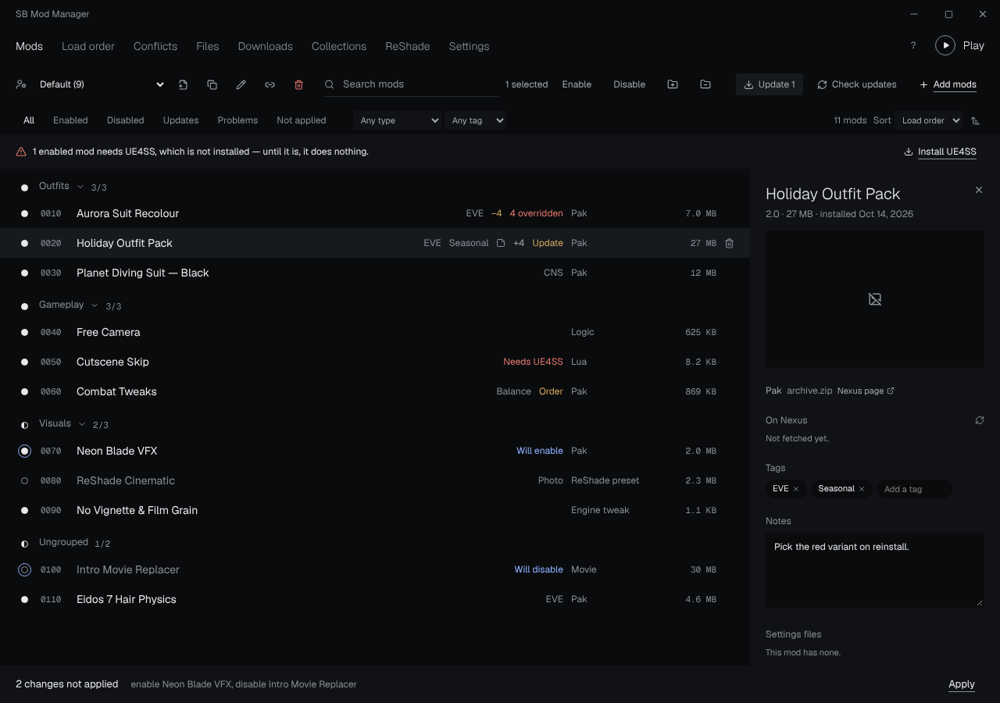

<div align="center">
  <h1><sub></sub> Stelle</h1>
  <h2>A mod manager for Stellar Blade</h2>
  <h3>It works out what a downloaded archive is, puts each piece where the game expects it, and can put the game folder back exactly as it found it.</h3>
  <p>For the PC version of Stellar Blade, on Steam or Epic.</p>
  <p>
    <a href="https://github.com/hitomihiumi/SB-Mod-Manager/releases/latest">Download</a> ·
    <a href="#get-started">Get started</a> ·
    <a href="#documentation">Docs</a> ·
    <a href="docs/mod-types.md">Where mods go</a> ·
    <a href="docs/limitations.md">Known limitations</a>
  </p>

  <p>
    <a href="https://github.com/hitomihiumi/SB-Mod-Manager/actions/workflows/ci.yml"></a>
    <a href="https://github.com/hitomihiumi/SB-Mod-Manager/releases/latest"></a>
    <a href="Cargo.toml"></a>
  </p>
  <br />
</div>

<p align="center">
  
  <br />
  <sub>The mods list, with groups and pending changes</sub>
</p>

<p align="center">
  <a href="https://github.com/hitomihiumi/SB-Mod-Manager/releases/latest"></a>
  <a href="#get-started"></a>
</p>

Stellar Blade mods do not all go in one place: paks go in `~mods`, Blueprint
mods in `LogicMods`, Lua mods in their own UE4SS folder plus a line in
`mods.txt`, ReShade next to the executable. Getting this wrong is the usual
reason a mod "doesn't work". Stelle gets it right for you.

## What you can do

<table>
  <tr>
    <td width="50%" valign="top">
      <strong><a href="docs/mod-types.md">Install anything</a></strong><br />
      Paks, IoStore sets, Blueprint and UE4SS Lua mods, ReShade presets, CNS outfits and engine tweaks are recognised by structure and routed on their own. One archive can hold several.
    </td>
    <td width="50%" valign="top">
      <strong><a href="docs/features.md#installing">Nexus, FOMOD, collections</a></strong><br />
      <em>Mod Manager Download</em> installs with no extra clicks. FOMOD wizards, variant pictures, collections and a watched downloads folder feed one queue.
    </td>
  </tr>
  <tr>
    <td width="50%" valign="top">
      <strong><a href="docs/features.md#running-the-game">Load order and profiles</a></strong><br />
      Priority is written into pak names so it really applies. Switch whole sets of mods in one click, or launch a profile from a desktop shortcut.
    </td>
    <td width="50%" valign="top">
      <strong><a href="docs/features.md#safety">Leaves nothing behind</a></strong><br />
      Every file written and every original displaced is recorded, so disabling everything restores the game folder byte for byte.
    </td>
  </tr>
</table>

- **See conflicts.** Reads pak and utoc indexes to name the asset two mods
  both replace and which one wins.
- **Hard links or a virtual file system.** Deploy into the game folder, or
  *(experimental)* leave it untouched, like Mod Organizer 2.
- **UE4SS, ReShade, DLSS, FSR.** Dependency checks, one-click UE4SS, ReShade
  presets, newer upscaler DLLs and *(experimental)* frame generation on RTX
  20/30.
- **Recover.** Restore points, save backups before each launch, game update
  detection and one-click repair.

All of it, in detail: **[Features](docs/features.md)**.

## Platforms

<details open>
<summary><strong>Windows</strong> · installer (NSIS), no admin rights needed</summary>
<blockquote>

Installs for the current user. Updates are signed
and arrive in the app, on the stable or the nightly channel.

[Download the latest installer](https://github.com/hitomihiumi/SB-Mod-Manager/releases/latest)

</blockquote>
</details>

<details>
<summary><strong>Linux</strong> · development only</summary>
<blockquote>

The library crates and their tests run on any machine, and CI exercises the
virtual file system under Wine. The app itself is built for Windows.
See [Development](docs/development.md).

</blockquote>
</details>

## Get started

1. Install Stelle from the [latest release](https://github.com/hitomihiumi/SB-Mod-Manager/releases/latest).
2. On first run, point it at your Stellar Blade install. Steam and Epic copies
   are found for you.
3. Drop one or more archives onto the window, or use *Mod Manager Download* on
   Nexus.
4. Enable what you want, order it, and launch.

<details>
<summary><strong>From source</strong></summary>

Requires Rust 1.82+, Node 22+ and pnpm; on Windows, the WebView2 runtime.

```sh
git clone https://github.com/hitomihiumi/SB-Mod-Manager
cd SB-Mod-Manager
pnpm install
pnpm tauri dev      # run it
pnpm tauri build    # produce an installer
```

</details>

## Documentation

| Need | Start here |
| --- | --- |
| Using it | [Features](docs/features.md) · [Where mods are installed](docs/mod-types.md) |
| Something not working | [Known limitations](docs/limitations.md) |
| Understanding the code | [Architecture](docs/architecture.md) |
| Development | [Development](docs/development.md) · [Releasing and forking](docs/releasing.md) |

## License

MIT
