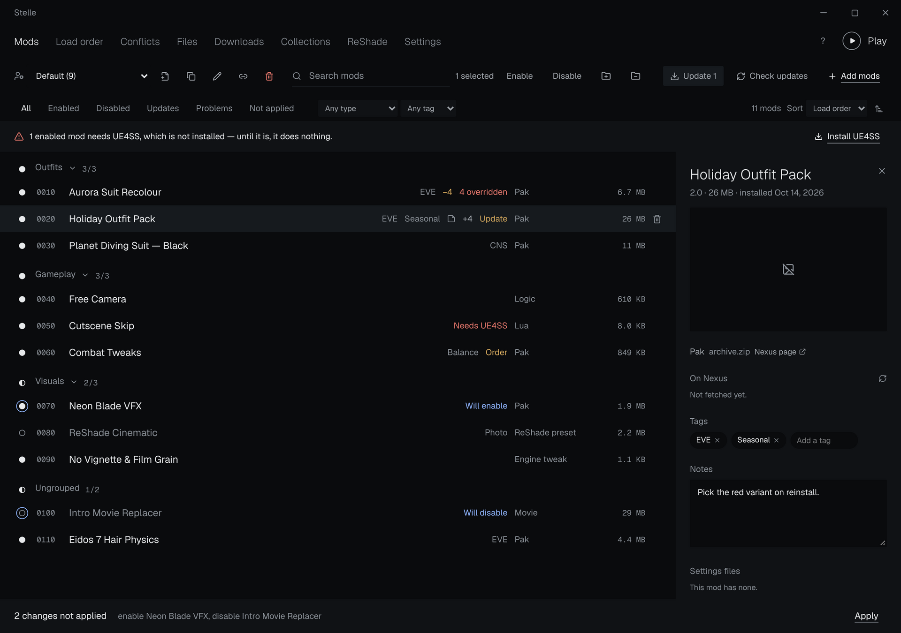
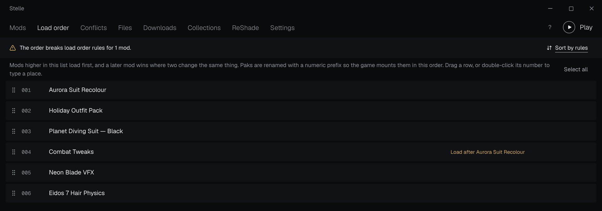
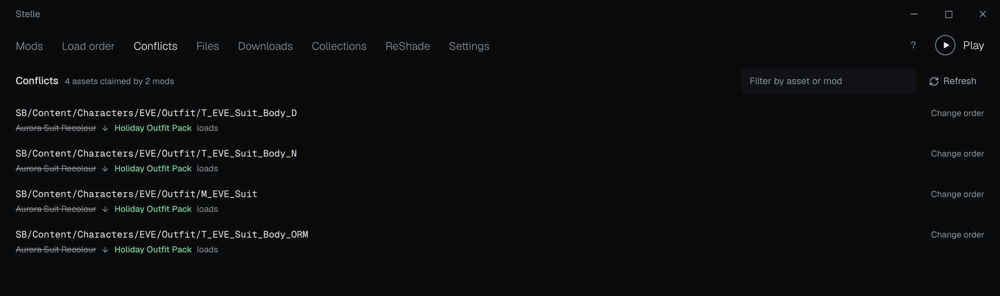

# Features



Everything Stelle does, grouped by what you are trying to do. For where each
kind of mod ends up, see [Where mods are installed](mod-types.md).

- [Installing](#installing)
- [Running the game](#running-the-game)
- [Understanding your setup](#understanding-your-setup)
- [Safety](#safety)

## Installing

- **Automatic type detection.** Every layout in [the table](mod-types.md) is
  recognised by structure; one archive can hold several, each routed on its
  own. Readmes and source art are set aside, and when nothing is conclusive it
  asks once and remembers.
- **IoStore done right.** `.pak`/`.utoc`/`.ucas` sets keep one base name and
  the `_P` suffix; incomplete sets are flagged.
- **Variant picker and FOMOD.** Archives with several versions of an outfit
  ask which one, with pictures. FOMOD installers run as a wizard, as in Mod
  Organizer 2. Answers are remembered for the next version.
- **Special cases handled.** Custom Nanosuit System outfits go where CNS
  reads them, `Engine.ini`-style tweaks are merged key by key into the game's
  own settings and taken back out exactly, and ReShade presets are recognised
  by their contents.
- **Batches, Nexus and collections.** Drop any number of archives at once.
  *Mod Manager Download* on Nexus installs with no further clicks (free
  accounts get one click per mod, as Nexus requires). Collections, mod lists
  (`.sbmm.json`) and a watched downloads folder feed the same queue.

## Running the game



- **Load order that applies.** Priority is written into pak file names
  (`0010_Outfit_P.pak`), and "load after" rules are kept as you reorder.
- **Two deployment modes.** Hard links into the game folder, or an
  experimental **virtual file system** like Mod Organizer 2's: the folder
  stays untouched, and whatever the game creates goes to an *overwrite* folder
  you can turn into a mod.
- **Profiles.** Separate enabled sets and load orders, switchable in one
  click, plus desktop shortcuts and a command line (see
  [below](#command-line)).
- **Dependencies checked.** Mods that need UE4SS, ReShade or another Nexus mod
  are flagged. UE4SS (Chrisr0's Stellar Blade build) installs and updates in
  one click.
- **ReShade presets.** List every preset with the effect files it is missing,
  pick the one ReShade starts with, and set one per profile.
- **DLSS, FSR and frame generation.** Swap in newer DLSS/FSR DLLs, and
  *(experimental)* run DLSS Frame Generation on RTX 20/30 cards via
  [dlssg_for_sm86](https://github.com/sdli1995/dlssg_for_sm86). Both are
  compatibility-checked and fully undoable.

### Command line

```sh
Stelle.exe --profile "Cosmetics only" --launch
```

Opens the named profile and starts the game. The same arguments are baked into
the desktop shortcuts Stelle creates for each profile.

## Understanding your setup



- **Conflicts.** Reads pak and utoc indexes to name the asset two mods both
  replace and which one wins. MO2-style `+N`/`−N`/*Redundant* flags cover
  loose files.
- **Explorer.** The Files screen has tabs, each showing the game folder as
  mods make it, the mod library as it lies on disk, or the clashing paths.
  In the library, files move by dragging (Ctrl+drag copies, also onto another
  tab) or Cut/Copy and Paste; they are renamed in place, duplicated, deleted
  into a trash the last delete can be undone from, and copied in by dropping
  them from Windows Explorer. Columns sort, a filter narrows the folder, tabs
  keep a back/forward history, and a preview shows pictures and text files.
  The mods touched are detected again so their files land where they should.
  Any file opens in the system's program, or in one you pick.
- **Mod details.** What a mod changes, its Nexus page info and requirements,
  notes, tags, a picture, and an editor for its INI/JSON/Lua settings. Your
  settings are kept across reinstalls and updates.
- **A fast list.** Filters, sorting, a context menu and keyboard control
  throughout (F1 lists the shortcuts).

## Safety

- **Leaves nothing behind.** Every file written and every original displaced
  is recorded, so disabling everything restores the folder byte for byte.
- **Recovers.** Restore points of the enabled set, save backups before each
  launch, game update detection and one-click repair of files changed outside
  the manager.
- **Housekeeping.** Disk usage cleanup, a movable library, a diagnostics zip,
  signed self-updates (stable or nightly) and optional Discord presence.

See also: [Known limitations](limitations.md).
